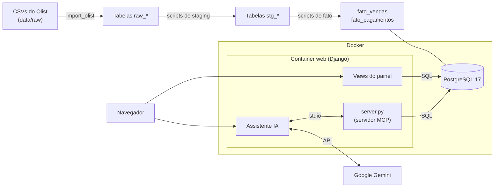
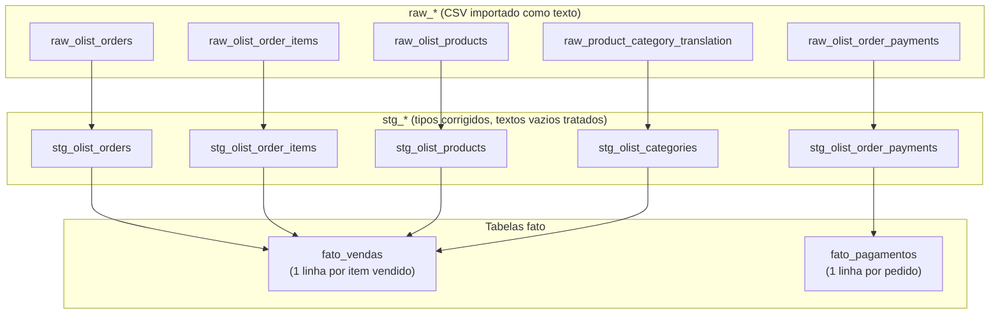

# Data Analyst AI

Painel de análise de vendas do e-commerce brasileiro **Olist**, com um **assistente de IA** que responde perguntas sobre os dados consultando o banco através de um **servidor MCP** (Model Context Protocol).

O projeto cobre o ciclo de um analista de dados: importação de dados brutos, tratamento em camadas, validação e reconciliação, análises estatísticas (tendências, anomalias e sazonalidade), visualização em um painel web e consultas em linguagem natural com respostas rastreáveis.

**Tecnologias:** Python 3.14 · Django 6 · PostgreSQL 17 · Docker · MCP · Google Gemini · Chart.js

---

## Sumário

- [Funcionalidades](#funcionalidades)
- [Arquitetura](#arquitetura)
- [Estrutura de pastas](#estrutura-de-pastas)
- [Como rodar](#como-rodar)
- [Pipeline de dados](#pipeline-de-dados)
- [Servidor MCP e assistente de IA](#servidor-mcp-e-assistente-de-ia)
- [Metodologia das análises](#metodologia-das-análises)
- [Interface](#interface)
- [Limitações](#limitações)
- [Fonte dos dados](#fonte-dos-dados)

---

## Funcionalidades

O painel tem seis páginas:

| Página | O que mostra |
|---|---|
| **Visão geral** | Total de pedidos, entregues, cancelados e valor pago; gráfico de pedidos por status |
| **Categorias** | As 10 categorias com maior faturamento, separando o valor dos produtos e do frete |
| **Evolução mensal** | Faturamento, pedidos, ticket médio e variação mês a mês |
| **Tendências** | Média móvel de 3 meses, classificação das variações e detecção de anomalias |
| **Sazonalidade** | Padrão por dia da semana e índice sazonal por mês do ano |
| **Assistente IA** | Perguntas em linguagem natural, respondidas com dados do banco |

Os números do painel e do assistente vêm **das mesmas consultas**. Assim, uma resposta do assistente sempre pode ser conferida no painel.

---

## Arquitetura



- **PostgreSQL** guarda os dados nas três camadas (raw, staging e fato).
- **Django** serve o painel. As views consultam o banco e entregam os números já formatados aos templates.
- **O servidor MCP** ([server.py](server.py)) expõe as consultas analíticas como ferramentas. O assistente o executa como subprocesso a cada pergunta, então ele não precisa de um container próprio.
- **O Gemini** decide quais ferramentas chamar e organiza a resposta. Ele não acessa o banco diretamente.

As análises de tendências e de sazonalidade ficam em [analytics/servicos.py](analytics/servicos.py) e são usadas tanto pelas views quanto pelo servidor MCP. Por isso o cálculo é único nos dois lugares.

---

## Estrutura de pastas

```
meu-servidor-mcp/
├── analytics/                  # App Django
│   ├── views.py                # Páginas do painel e formatação dos números
│   ├── servicos.py             # Análises de tendências e sazonalidade (compartilhadas com o MCP)
│   ├── assistente_ia.py        # Integração Gemini + cliente MCP
│   ├── urls.py
│   ├── templates/analytics/    # Uma página por análise
│   └── management/commands/
│       └── import_olist.py     # Comando: python manage.py import_olist
├── config/                     # Configurações do Django (settings, urls)
├── scripts/                    # Pipeline de dados, validações e análises exploratórias
├── static/
│   ├── css/estilo.css          # Estilos, modo claro e modo noturno
│   └── js/graficos.js          # Gráficos (Chart.js), menu e troca de tema
├── templates/base.html         # Layout comum: menu lateral e cabeçalho
├── server.py                   # Servidor MCP com as ferramentas de consulta
├── teste.py                    # Teste rápido: lista as ferramentas do servidor MCP
├── data/raw/                   # CSVs do Olist (não versionados)
├── docker-compose.yml          # Serviços postgres e web
├── Dockerfile                  # Imagem da aplicação web
└── requirements.txt
```

---

## Como rodar

### Pré-requisitos

- [Docker Desktop](https://www.docker.com/products/docker-desktop/)
- Os CSVs do [Brazilian E-Commerce Public Dataset by Olist](https://www.kaggle.com/datasets/olistbr/brazilian-ecommerce), na pasta `data/raw/`
- Uma chave da API do Gemini ([Google AI Studio](https://aistudio.google.com/apikey)), necessária apenas para o assistente

### 1. Configure o `.env`

Crie um arquivo `.env` na raiz do projeto:

```env
POSTGRES_DB=data_analyst
POSTGRES_USER=analyst
POSTGRES_PASSWORD=escolha-uma-senha
POSTGRES_HOST=localhost
POSTGRES_PORT=5433

GEMINI_API_KEY=sua-chave-do-gemini

# Opcionais
DJANGO_SECRET_KEY=uma-chave-longa-e-aleatoria
DJANGO_DEBUG=True
```

O `.env` está no `.gitignore` e nunca deve ser versionado. `POSTGRES_HOST` e `POSTGRES_PORT` valem para rodar fora do Docker. Dentro do container `web`, o `docker-compose.yml` os substitui por `postgres` e `5432`.

### 2. Suba os containers

```bash
docker compose up -d --build
```

Isso sobe dois containers:

| Container | Porta | Função |
|---|---|---|
| `data_analyst_postgres` | 5433 | Banco de dados |
| `data_analyst_web` | 8000 | Painel Django |

### 3. Carregue os dados (somente na primeira vez)

Os comandos abaixo importam os CSVs e montam as camadas de staging e de fato. Rode-os nesta ordem:

```bash
# Importa os 9 CSVs para as tabelas raw_*
docker compose exec web python manage.py import_olist

# Camada staging
docker compose exec -T web python manage.py shell < scripts/criar_staging.py
docker compose exec -T web python manage.py shell < scripts/criar_staging_itens.py
docker compose exec -T web python manage.py shell < scripts/criar_staging_produtos.py
docker compose exec -T web python manage.py shell < scripts/criar_staging_categorias.py
docker compose exec -T web python manage.py shell < scripts/criar_staging_pagamentos.py

# Camada fato
docker compose exec -T web python manage.py shell < scripts/criar_fato_vendas.py
docker compose exec -T web python manage.py shell < scripts/criar_fato_pagamentos.py
```

Cada script mostra um resumo de validação ao terminar, com contagem de registros, IDs vazios e valores ausentes.

### 4. Acesse

Abra **http://localhost:8000/**.

Com o código montado como volume, alterações em Python, HTML, CSS e JS aparecem sem reconstruir a imagem. Só rode `--build` de novo se mudar o `requirements.txt`.

### Rodar sem Docker (opcional)

Com o PostgreSQL no ar (`docker compose up -d postgres`):

```bash
python -m venv .venv
.venv\Scripts\activate          # Linux/macOS: source .venv/bin/activate
pip install -r requirements.txt
python manage.py runserver
```

Não rode as duas formas ao mesmo tempo, porque ambas usam a porta 8000.

---

## Pipeline de dados

Os dados passam por três camadas. Os scripts de staging e de fato recriam apenas a própria tabela, então as tabelas `raw_*` nunca são alteradas.



**`fato_vendas`** é a base do painel. Ela junta pedido, item, produto e categoria, com as colunas `data_pedido`, `order_status`, `product_category_name`, `categoria_ingles`, `valor_item`, `valor_frete` e `valor_total_item`.

### Scripts auxiliares

A pasta [scripts/](scripts/) também guarda as etapas de investigação que orientaram o tratamento. Eles são executados da mesma forma (`python manage.py shell < scripts/<nome>.py`):

| Tipo | Scripts | Objetivo |
|---|---|---|
| Validação | `validar_banco`, `validar_fato_vendas`, `validar_periodo_vendas` | Conferir contagens, período e consistência |
| Reconciliação | `validar_reconciliacao`, `resumo_reconciliacao_status`, `investigar_divergencias` | Comparar o valor pago com itens + frete, por pedido e por status |
| Diagnóstico | `diagnostico_dados`, `investigar_entregas`, `investigar_categorias` | Datas ausentes, entregas sem data e categorias sem tradução |
| Exploração | `analise_*` | Primeiras análises de pedidos, faturamento, entregas e pagamentos |

---

## Servidor MCP e assistente de IA

### Ferramentas do servidor MCP

O [server.py](server.py) expõe estas ferramentas:

| Ferramenta | Retorna |
|---|---|
| `consultar_indicadores` | Pedidos totais, entregues e cancelados; valor total pago |
| `consultar_faturamento_por_categoria` | Top 10 categorias por faturamento, com frete, itens e pedidos |
| `consultar_evolucao_mensal` | Faturamento, frete, pedidos, ticket médio e variação por mês |
| `analisar_tendencias_vendas` | Média móvel, classificação das variações e anomalias |
| `analisar_sazonalidade_vendas` | Índices sazonais mensais e padrão por dia da semana |
| `consultar_projeto` | Descrição do projeto |
| `somar` | Exemplo mínimo de ferramenta (usado em testes) |

Para conferir se o servidor está respondendo:

```bash
python teste.py
```

### Como o assistente responde

1. O Django abre o servidor MCP como subprocesso e lista as ferramentas disponíveis.
2. As ferramentas são enviadas ao Gemini (`gemini-3.6-flash`) junto com a pergunta.
3. O modelo pede as ferramentas de que precisa. O assistente as executa e devolve os resultados, em até 5 rodadas.
4. A resposta final é organizada em três seções:
   - **Dados:** apenas valores retornados pelas ferramentas, citando qual foi usada.
   - **Cálculos:** indicadores derivados, com fórmula e valores.
   - **Interpretações:** sempre marcadas como hipóteses.

As instruções do modelo proíbem citar números que não tenham vindo de uma ferramenta. Quando não existe ferramenta para a pergunta, o assistente informa isso em vez de estimar.

No plano gratuito do Gemini, o limite é de cerca de 20 requisições por dia, e cada pergunta usa pelo menos 2.

---

## Metodologia das análises

### Tendências

- **Apenas meses completos.** Os meses nas pontas do período, com poucos dias de venda, ficam fora das comparações e são listados à parte.
- **Média móvel de 3 meses** para suavizar a série.
- **Variação mês a mês**, classificada como crescimento, queda ou estável (0,0%). Variações sobre uma base muito pequena (abaixo de 1% da média mensal) não são classificadas.
- **Anomalias pelo Modified Z-Score**: `0,6745 × (variação − mediana) ÷ MAD`, com anomalia quando o valor absoluto passa de 3,5. Mediana e MAD são resistentes aos próprios valores extremos, ao contrário de média e desvio-padrão.

### Sazonalidade

- **Por dia da semana:** faturamento médio de cada dia em semanas completas, com média, mediana, MAD e índice em relação à média dos 7 dias. É a parte mais confiável, por ter cerca de 90 semanas de observação.
- **Por mês do ano:** faturamento por dia dividido pela tendência (média móvel centrada de 12 meses), o que separa o crescimento do negócio do efeito sazonal.
- **Limite de 1%:** só são destacadas diferenças acima de 1%. É um critério descritivo, não um teste de significância.
- **Cautela explícita:** a base tem menos de 2 anos civis completos, então os índices mensais são apresentados como indicativos.

### Faturamento

Salvo indicação em contrário, faturamento é a soma de `valor_item` (preço dos produtos, **sem frete**), considerando todos os status de pedido.

---

## Interface

- Layout com menu lateral fixo no computador e gaveta no celular.
- **Modo noturno** pelo botão no cabeçalho. A escolha fica salva no navegador, e os gráficos são redesenhados nas cores do tema.
- **Cores dos gráficos validadas para daltonismo e contraste**, nos dois temas. Cada gráfico tem uma tabela com os mesmos dados, então nenhum valor depende só da cor ou da dica do mouse.
- Acessibilidade: foco visível na navegação por teclado, página atual marcada para leitores de tela (`aria-current`) e respeito à preferência de reduzir movimento.

---

## Limitações

- O período útil vai de 09/2016 a 08/2018, com menos de 2 ciclos anuais completos, o que limita conclusões sobre sazonalidade mensal.
- A base não traz campanhas, datas comemorativas nem eventos externos. Explicações para picos e quedas são hipóteses.
- O servidor usado é o de desenvolvimento do Django (`runserver`). Publicar na internet exigiria `DEBUG=False`, uma `DJANGO_SECRET_KEY` própria, Gunicorn e um servidor de arquivos estáticos.
- O projeto ainda não tem testes automatizados.

---

## Fonte dos dados

[Brazilian E-Commerce Public Dataset by Olist](https://www.kaggle.com/datasets/olistbr/brazilian-ecommerce), disponível no Kaggle sob a licença **CC BY-NC-SA 4.0**. São cerca de 100 mil pedidos reais e anonimizados, feitos entre 2016 e 2018 em diversos marketplaces do Brasil.

Os CSVs não fazem parte deste repositório. Baixe-os no Kaggle e coloque-os em `data/raw/`.
